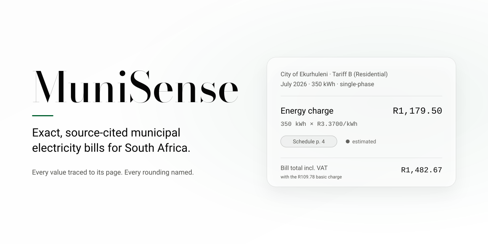
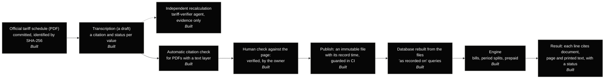
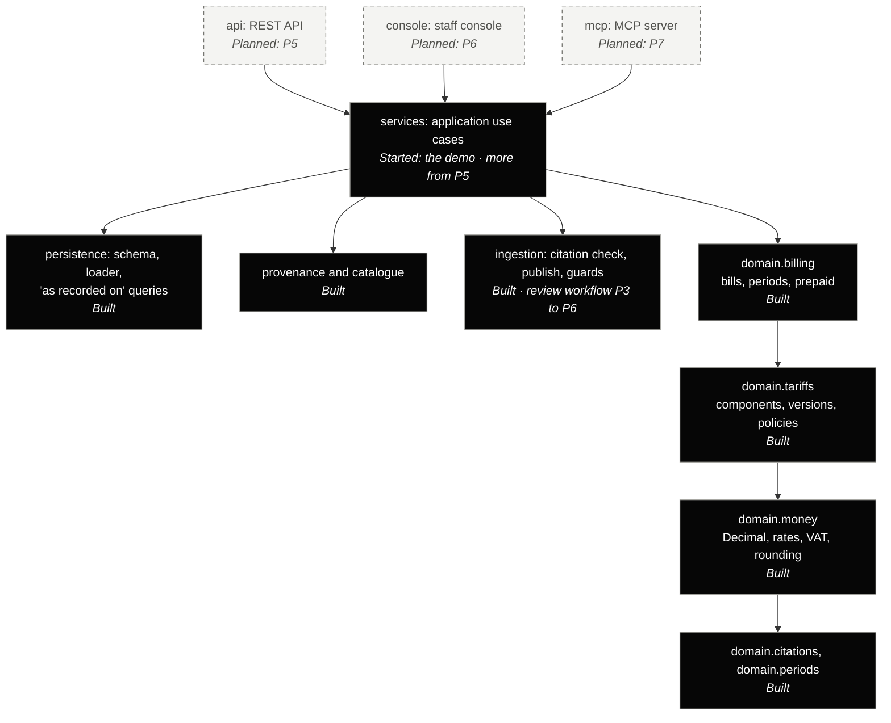

<picture>
  <source media="(prefers-color-scheme: dark)" srcset="docs/assets/hero-dark.svg">
  
</picture>

**Exact, source-cited municipal electricity bills for South Africa: every value traced to its page, every rounding named.**

[](https://github.com/Josh-Heath123/MuniSense/actions/workflows/ci.yml)


## The problem

Municipal electricity tariffs are published as long PDF schedules. Ekurhuleni's signed 2026/27 schedule is a 37-page scan.
Checking a bill or a prepaid purchase against them by hand is slow and easy to get wrong.
Software and AI agents need exact answers that can be traced back to the page they came from.

## What it does now

Phase 2, versioned storage, passed its gate on 2026-11-21. Phase 4, time-of-use and demand, is in progress while Phase 3 waits for Ekurhuleni household bills and receipts. MuniSense is a Python library with a local database; there is no API or user interface yet.

| Capability | Status |
| --- | --- |
| Exact money and rates: `Decimal` only, floats refused, every rounding at a named policy point | Built |
| A citation (document SHA-256, page, printed text) and a status (verified, estimated or user-provided) on every tariff value | Built |
| Forward bills: fixed charges, flat, block and seasonal energy, levies, free basic allocations, VAT | Built |
| Billing periods split across months, tariff versions, seasons and VAT changes, pro-rated by a named policy | Built |
| Prepaid purchases: the kWh a rand amount buys, given the month's earlier purchases | Built |
| City of Ekurhuleni 2026/27 Tariff B (Residential) and the SARS VAT rate, published with a citation per value | Built; values checked by hand by the owner are `verified`; VAT treatment, season dates and the rounding and billing policies `estimated` |
| Versioned storage, the publish step, an automatic citation check, publication guards | Built (P2, gate pending) |
| REST API, staff console, MCP server for AI agents | Planned (P5, P6, P7) |

### An example from the real tariff

<!-- demo:start -->
TARIFF B (RESIDENTIAL), single-phase, July 2026, 350 kWh (`uv run poe demo`):

| Line | Quantity | Rate | Amount | Source | Status |
| --- | --- | --- | ---: | --- | --- |
| Basic charge | 1 month | R109.78/month | R109.78 | Ekurhuleni schedule, p. 4 | estimated |
| Energy charge | 350 kWh | R3.3700/kWh | R1,179.50 | Ekurhuleni schedule, p. 4 | estimated |
| Subtotal | | | R1,289.28 | | |
| VAT | 15% | | R193.39 | SARS VAT 404, p. 15 | verified |
| **Total** | | | **R1,482.67** | | **estimated** |

Warnings on the bill:

- Some values used are estimated, not verified against the source; see each line's status.
- Rounding policy 'ekurhuleni-estimated' is estimated; cent-level differences from a real bill are possible.
<!-- demo:end -->

This table is the engine's own output, read from the published data through the database, and a test keeps it identical to the code. The rates and the VAT rate were checked by hand by the owner against the City of Ekurhuleni's signed 2026/27 schedule (a scan) and SARS's VAT guide, and are `verified`. The basic and energy lines are still `estimated`, because the schedule says only that its prices exclude VAT, so each charge's VAT treatment is an inference; the season dates and the rounding and billing policies are also assumptions until they can be confirmed from real Ekurhuleni bills or receipts.

## Engineering highlights

Figures are from the [P2 gate report](docs/reports/2026-11-20-P2-gate.md).

- **1,170 tests, 100% line and branch coverage** of the code built so far, run in CI on every pull request.
- **90.2% mutation score** on the billing engine: 1,380 of 1,530 injected bugs caught. Re-run at the P2 gate with the same result. Every surviving mutant is reviewed and listed in [mutation-p1-15.md](docs/quality/mutation-p1-15.md).
- **No floats, no silent rounding.** Arithmetic is exact or refused. Rounding happens only at points a supplier's policy names ([ADR-0005](docs/adr/0005-decimal-money-and-rounding-policies.md), [ADR-0011](docs/adr/0011-pro-rating-quantisation-point.md)). Tests: [`test_money.py`](tests/unit/domain/money/test_money.py), [`test_rounding.py`](tests/unit/domain/money/test_rounding.py).
- **A citation on every value.** Each value has its own citation and status, and every result reports the weakest status of what it used ([ADR-0006](docs/adr/0006-provenance-and-verification-status.md); [`test_cited_values.py`](tests/unit/domain/citations/test_cited_values.py)).
- **A pure domain.** The calculation core does no I/O and imports only the standard library and Pydantic. This is enforced by import-linter and a purity test ([ADR-0004](docs/adr/0004-declarative-tariff-components.md); [`test_domain_purity.py`](tests/unit/test_domain_purity.py)).
- **Published tariff data is immutable and has two timelines.** A tariff version is published once, as a file with its record time; a correction supersedes it and never edits it. The database is rebuilt from the files, and an exclusion constraint refuses two versions of a tariff valid at the same time, now or in any past snapshot ([ADR-0003](docs/adr/0003-postgresql-bitemporal-tariff-versions.md), [ADR-0012](docs/adr/0012-tariff-files-and-database-projection.md); [`test_schema.py`](tests/integration/persistence/test_schema.py), [`test_loader.py`](tests/integration/persistence/test_loader.py)).
- **A deterministic citation check.** Before anything is published, each printed text must be found verbatim on its cited page (after whitespace is normalised), or the page must be shown to have no text layer, in which case only a person can verify it ([`test_citation_check.py`](tests/unit/ingestion/test_citation_check.py)).
- **Property tests against independent references.** A bill is never negative and never falls as use rises. VAT adds up. Splitting a period changes the total by no more than the named roundings. A month of prepaid purchases costs what the month is billed ([`tests/property/`](tests/property/domain/billing/)).

## How it works





Arrows point at what a module may use; only the interface, service and domain edges are drawn (within the data layer, persistence uses ingestion, which uses provenance and the domain; import-linter enforces the rules). Solid dark modules are built; dashed light ones are planned, with the phase that builds them. Pine green is kept for what is verified or important, so it is not used for "built".

## Status

| Phase | What | Status |
| --- | --- | --- |
| P0 | Foundation: tooling, CI, hooks, decisions | Built (gate 2026-11-17) |
| P1 | Calculation core | Built (gate 2026-11-18) |
| P2 | Versioned storage, provenance, citation check, publishing | Built (gate 2026-11-21) |
| P3 | Ekurhuleni pilot: schedules loaded, golden cases from real bills and receipts | Planned |
| P4 | Time-of-use and demand | In progress |
| P5 | REST API v1 | Planned |
| P6 | Staff console | Planned |
| P7 | MCP server for AI agents | Planned |
| P8 | More suppliers | Planned |
| P9 | Pilot validation | Planned |
| P10 | Production | Planned, only with the owner's approval of the cost |

The live tracker is [`docs/status.md`](docs/status.md); the phases and their proofs are in [`docs/roadmap.md`](docs/roadmap.md).

## How it's built

MuniSense is built by Claude Code, working under the direction of the owner, Josh Heath. The owner makes the product decisions, accepts the architecture decision records and approves each phase gate. Claude Code plans, implements, tests and documents.

Every pull request is reviewed by an independent code-review agent before it is merged. When tariff data changes, a tariff-verifier agent also recalculates each value and compares it with the source page. An agent's check never makes a value verified; that takes a person.

Pull requests are merged only when continuous integration is green, and GitHub enforces it: a ruleset on `main` requires a pull request and the green CI check, and blocks force pushes ([ADR-0014](docs/adr/0014-github-ruleset-protects-main.md)). A pull request that publishes tariff data may change nothing outside `data/` (checked in CI), and by a working rule the owner approves each one.

Mutation testing measures whether the billing engine's tests catch injected bugs. It was last run at the P2 gate (90.2%, unchanged since Phase 1), and is re-run before each phase gate that changes the engine or its tests.

The rules are in [`CLAUDE.md`](CLAUDE.md).

## Quick start

You need [uv](https://docs.astral.sh/uv/) and git. uv installs Python 3.13 and every locked dependency.

```bash
uv sync               # install the locked dependencies
uv run poe check      # lint, type-check and fast tests
```

The example bill above needs the local database (Docker, see [`docs/development.md`](docs/development.md)):

```bash
docker compose up -d db   # PostgreSQL
uv run poe db-bootstrap   # once per volume: roles and schema
uv run poe db-rebuild     # load the committed publications
uv run poe demo           # print the example bill, from the published data and engine
```

Setting up the owner's Windows and WSL2 machine, and running the Docker-based commands, is covered in [`docs/development.md`](docs/development.md).

## Documentation

| Document | What |
| --- | --- |
| [`docs/status.md`](docs/status.md) | Current phase, tasks, decisions |
| [`docs/roadmap.md`](docs/roadmap.md) | Phases, deliverables, gates |
| [`docs/architecture/overview.md`](docs/architecture/overview.md) | Modules, dependency rules, data model |
| [`docs/adr/`](docs/adr/) | Architecture decision records |
| [`docs/brand.md`](docs/brand.md) | Design system (colour, type, glass, motion) |
| [`docs/README.md`](docs/README.md) | The full documentation map |

## Licence and data

Proprietary. All rights reserved ([`LICENSE`](LICENSE)).

- **Official documents.** The tariff schedules and other official documents in [`data/sources/`](data/sources/) belong to their publishers (the City of Ekurhuleni and the South African Revenue Service). They are kept so that every value can be cited to its page.
- **Published tariff data.** The versions in [`data/tariffs/`](data/tariffs/) and [`data/vat/`](data/vat/) are transcriptions with a citation and a status on every value: `verified` where the owner checked it by hand against the page, otherwise `estimated` with the reason.
- **User-provided figures.** [`data/observations/`](data/observations/) holds user-provided figures only, with no personal details. These are not tariff data.

MuniSense is not affiliated with any municipality, Eskom, NERSA or SARS. Its results are calculations, not bills.
